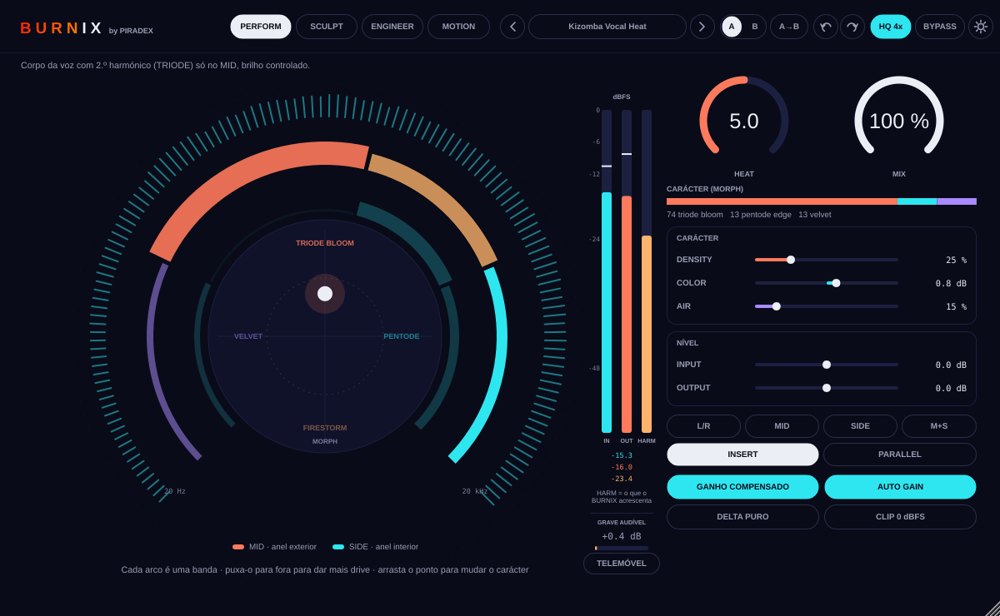
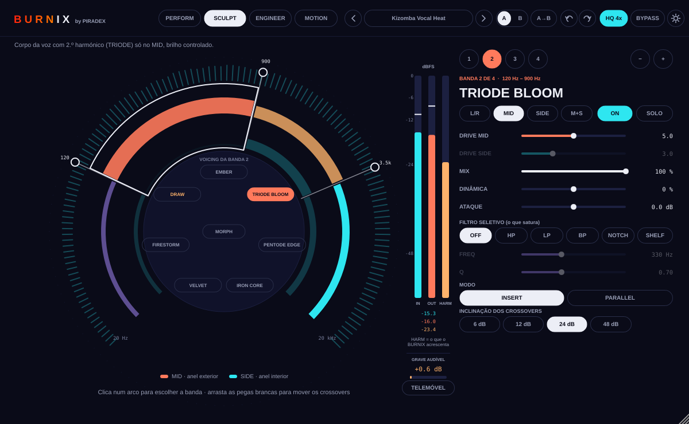
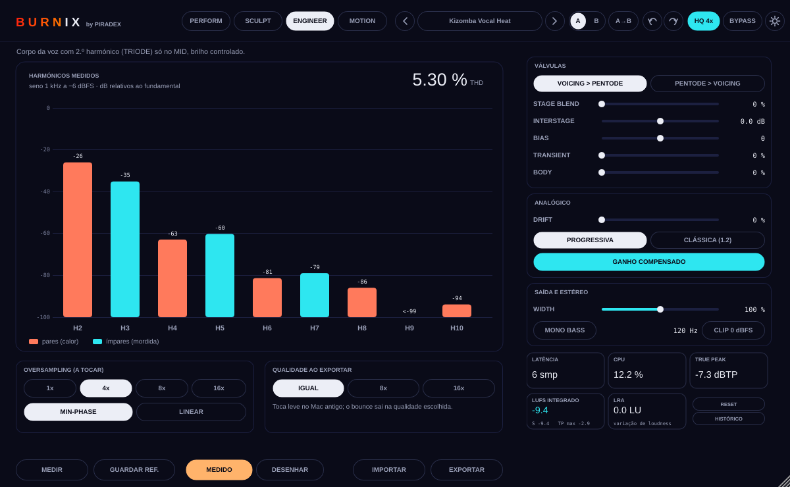

# BURNIX by PIRADEX

**Harmonic Color Engine** — saturação de válvulas multibanda, seletiva por frequência, com processamento Mid/Side.
VST3 + AU (macOS universal Intel/Apple Silicon, 10.13+) e VST3 (Windows x64). JUCE 8 / C++20.
Criador e Desenvolvedor **Ricardo Amorim / Juninho Piradex** · Beatfreak Music · https://www.beatfreakstudio.com

> **Versão atual: 1.0.2** (todos os plugins Piradex passaram a ter a mesma numeração; as versões abaixo de "Histórico" são da numeração antiga).
>
> * **Login:** obrigatório desde a 1.0.1 — senha master, senha beta (válida até 31/12/2026) ou chave de licença validada online no PCC. Sem sessão, o áudio passa intacto.
> * **Instaladores (loja www.beatfreakstudio.com/loja):** Mac Apple Silicon (`…-macOS-AppleSilicon.pkg`), Mac Intel com macOS 10.13 ou mais recente (`…-macOS-Intel-macOS10.13.pkg`), Windows (`…-Windows-Setup.exe`) e AAX para Pro Tools (`…-AAX-*.zip`, ver LEIA-ME-AAX.txt).
> * **Criador e desenvolvedor:** Ricardo Amorim / Juninho Piradex.



| | |
|---|---|
|  |  |

## O que faz
* 1 a 6 bandas Linkwitz-Riley (24/48 dB/oct, soma plana) · rota por banda L/R, MID, SIDE ou M+S com drives independentes.
* Seis voicings originais: EMBER, TRIODE BLOOM, PENTODE EDGE, IRON CORE, VELVET, FIRESTORM — e um morph entre quatro deles.
* Filtro seletivo por banda (HP/LP/BP/NOTCH/SHELF), modos INSERT e PARALLEL, 2.º estágio PENTODE, bias, density, transient preserve.
* Oversampling 1x / 4x / 8x / 16x (MIN-PHASE ou LINEAR), latência reportada ao DAW, bypass verdadeiro (null exato).
* DELTA (ouvir só o que é acrescentado), AUTO GAIN opt-in, COLOR / BODY / AIR, WIDTH, MONO BASS, true peak, espectro.
* Interface "Órbita v2" (PERFORM / SCULPT / ENGINEER), escala 75–200 %, 160 presets de fábrica, presets do utilizador, A/B, undo.
* Mesmo login dos plugins Piradex: login obrigatório desde a 1.0.1: senha master (offline) ou licença PCC (online, assinada).

## Documentação
* [PRD, arquitetura, contrato de parâmetros e critérios](Docs/PRD.md)
* [Resultados reais dos testes](Docs/TEST_RESULTS.md)
* [Manual PT](Docs/MANUAL_PT.md) · [Manual EN](Docs/MANUAL_EN.md)
* [Licenciamento e PCC](Docs/LICENSING_PCC.md) · [Assinatura e notarização](Docs/SIGNING.md) · [Licenças de terceiros](Docs/LICENSES.md)

## Compilar
```bash
# testes do DSP (sem JUCE)
cmake -B build-t -DBX_BUILD_TESTS=ON -DBX_ONLY_TESTS=ON && cmake --build build-t && ./build-t/test_dsp
# plugin + teste de integracao (descarrega o JUCE 8.0.15)
cmake -B build -DBX_BUILD_SMOKE=ON -DCMAKE_BUILD_TYPE=Release
cmake --build build --config Release --target Burnix_VST3 BurnixSmoke
```
O GitHub Actions (`.github/workflows/build.yml`) corre os testes, compila macOS (VST3 + AU universal, auval, pluginval)
e Windows (VST3, pluginval), cria o `.pkg` e o `.exe` e publica uma release com checksums.
